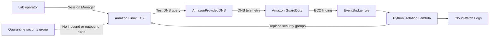
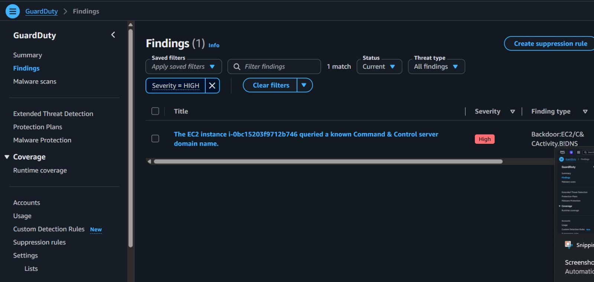
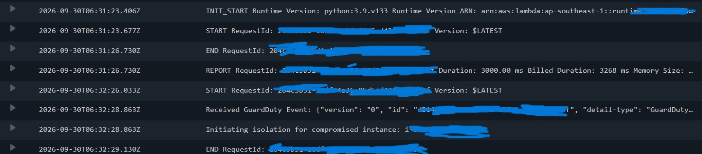
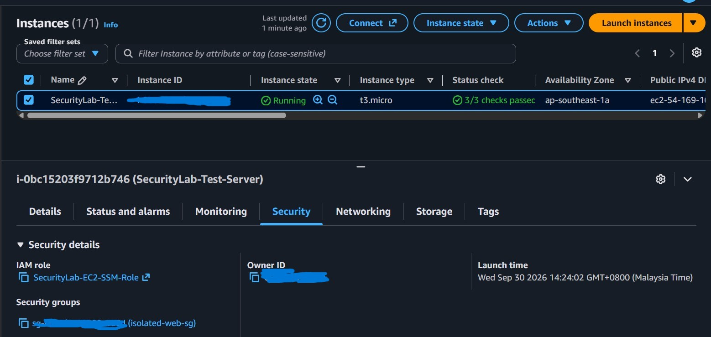

# AWS GuardDuty EC2 Isolation Lab

A hands-on cloud security lab that uses Terraform, Amazon GuardDuty, Amazon EventBridge, and AWS Lambda to detect suspicious EC2 DNS activity and replace the instance's security group with a quarantine group.

The project demonstrates infrastructure as code, event-driven incident response, IAM permissions, and troubleshooting with CloudWatch Logs. It is a learning lab in `ap-southeast-1` (Singapore).

## Architecture



Terraform provisions:

- A VPC, a public subnet, and an unused private subnet, with an internet gateway and public routing. No NAT gateway is deployed.
- One Amazon Linux 2023 `t3.micro` instance with an automatically assigned public IPv4 address and an IAM role for Systems Manager access.
- A normal security group allowing TCP 443 inbound and outbound, and a quarantine security group with no rules. No web application is installed by this project.
- A regional GuardDuty detector and an EventBridge rule matching findings whose resource type is `Instance`.
- A Python Lambda function that reads the instance ID from the finding and replaces its security groups using `ec2:ModifyInstanceAttribute`.
- An S3 bucket with SSE-S3 encryption and public access blocked. The bucket is a storage/security exercise; this version does not send GuardDuty findings or Lambda logs to it.

## What I tested

| Stage | Evidence and outcome |
| --- | --- |
| Detection | A DNS lookup of AWS's documented test domain generated `Backdoor:EC2/C&CActivity.B!DNS` for the lab instance. The finding appeared approximately three minutes after the query. |
| Event delivery | Lambda execution logs contained the GuardDuty event, confirming that the EventBridge rule delivered it. |
| Failure diagnosis | The first execution and both automatic retries exceeded Lambda's default three-second timeout. |
| Fix | Increased the Terraform-configured Lambda timeout to 30 seconds. `terraform validate` passed, and the plan showed one in-place update. |
| Remediation retest | The EC2 console screenshot shows the instance using `isolated-web-sg` after retesting remediation. |

Detection and event delivery were observed on the original run. The final quarantine screenshot documents remediation after the timeout fix; it does not claim that the original automatic execution completed successfully.

### GuardDuty detection



### Investigating the timeout



These are the original failure-investigation logs, not a successful isolation log.

### Quarantine applied



The instance remains **Running**. In this lab, isolation means changing its network security group, not stopping or terminating the instance.

## Repository layout

| File | Purpose |
| --- | --- |
| `main.tf` | AWS provider, VPC, subnets, routing, EC2, and security groups |
| `iam.tf` | EC2 and Lambda roles and policies |
| `guardduty.tf` | GuardDuty, Lambda packaging/function, EventBridge rule, and invocation permission |
| `s3.tf` | Encrypted S3 bucket with public access blocked |
| `outputs.tf` | VPC, instance, public IP, and bucket outputs |
| `lambda/isolate_ec2.py` | EC2 security-group replacement handler |
| `.terraform.lock.hcl` | Provider versions and integrity checksums |
| `.gitignore` | Excludes local state, plans, variable values, credentials, and generated artifacts |

## Run the lab

Use a sandbox AWS account with permissions to manage the resources in this configuration. GuardDuty operates across the account within a region, and the event rule is not restricted to this lab's instance. An account with an existing GuardDuty detector in Singapore requires an explicit decision about importing/reusing that detector before applying this configuration.

Prerequisites: Terraform 1.5 or newer, AWS CLI authentication configured locally, and access to the AWS console. The code does not embed AWS credentials.

```powershell
terraform init
terraform validate
terraform plan
terraform apply
```

Review the plan before approving it. The AWS provider is constrained to version 5.x; the committed lock file records the selected providers. The Lambda currently uses Python 3.9, matching the original lab run; this runtime is deprecated and should be upgraded and retested before future deployment. See [AWS runtime support dates](https://docs.aws.amazon.com/lambda/latest/dg/lambda-runtimes.html).

## Generate a detection

1. Select **Singapore** in the AWS console and confirm that GuardDuty is enabled.
2. Open **EC2 > Instances > SecurityLab-Test-Server > Connect > Session Manager**.
3. Run this in the EC2 terminal:

   ```bash
   dig guarddutyc2activityb.com
   ```

   If `dig` is unavailable, a lookup through the system resolver is another option:

   ```bash
   getent ahostsv4 guarddutyc2activityb.com
   ```

   This is a DNS-only test using [AWS's documented test domain](https://docs.aws.amazon.com/guardduty/latest/ug/guardduty_finding-types-ec2.html#backdoor-ec2-ccactivity-b-dns). Use the default AWS DNS resolver. A response with no address does not mean the DNS request failed.

4. Allow time for processing, then refresh **GuardDuty > Findings**. Detection is not instantaneous.
5. Check `/aws/lambda/SecurityLab-Isolate-EC2` in CloudWatch Logs and the instance's **Security** tab. Successful remediation assigns `isolated-web-sg`; Session Manager may disconnect.

GuardDuty accesses the relevant DNS telemetry automatically; separate Route 53 query logging is not required for this test. Repeated activity can update an existing finding, so repeating the lookup does not guarantee an immediate new EventBridge invocation.

## Retest remediation after a failure

Lambda retries asynchronous function errors twice by default. Changing the timeout after those attempts have finished does not replay the event.

To test the handler directly, open **Lambda > SecurityLab-Isolate-EC2 > Test** and use the following event, replacing the placeholder with the current lab instance ID from `terraform output -raw instance_id`:

```json
{
  "detail": {
    "resource": {
      "resourceType": "Instance",
      "instanceDetails": {
        "instanceId": "REPLACE_WITH_YOUR_LAB_INSTANCE_ID"
      }
    }
  }
}
```

This invokes the real remediation action and tests Lambda/IAM/EC2 behavior. It does not generate a new GuardDuty detection or retest EventBridge. A successful response contains `Successfully isolated instance`; verify the security group as well.

To restore lab connectivity, replace `isolated-web-sg` with the original `hardened-web-sg` through the EC2 console. Terraform also detects the quarantine assignment as drift, so a later apply can propose restoring the original group.

## Cost and cleanup

This is not an always-free deployment. At Singapore list prices checked on September 30, 2026, one continuously running Linux `t3.micro`, its default 8 GiB gp3 root disk, and one public IPv4 address total approximately **US$14.05 per month** using 730 hours. This excludes GuardDuty, CPU surplus credits, logs, requests, chargeable data transfer, and taxes. Account credits or trial eligibility affect what you pay.

Destroy the lab after practice:

```powershell
terraform destroy
```

Use the original Terraform state and confirm that destruction completes without errors. The EC2 root disk is deleted on termination under the selected AMI's defaults, and its automatically assigned public IPv4 address is released. Deleting the Terraform-managed GuardDuty detector disables it in Singapore; it does not disable GuardDuty in other regions.

Two cleanup details matter in this implementation:

- The Lambda-created CloudWatch log group is not managed by Terraform. Delete `/aws/lambda/SecurityLab-Isolate-EC2` separately if its logs are no longer needed.
- The S3 bucket must be empty before Terraform can delete it. Preserve anything needed, remove unwanted objects, and rerun destroy if bucket deletion fails.

Deleting resources stops their future usage charges. Existing charges can appear later because billing data is delayed. Keep state and backup files locally for infrastructure management; never publish them.

## Limitations and next improvements

- **Scope of automation:** The rule matches all EC2-instance findings in the region. It has no lab-tag restriction, severity threshold, or sample-finding exclusion. Lambda's EC2 permissions currently use `Resource: "*"`. Narrow the target scope and permissions before sharing an account with other workloads.
- **Isolation behavior:** Replacing security groups blocks new traffic covered by those rules, but does not guarantee immediate termination of every tracked connection. Security groups cannot block the Amazon-provided DNS resolver. This is not complete host containment.
- **Failure recovery:** The function has no dead-letter queue, failure destination, or storage of the original security-group assignment. The timeout exercise demonstrates why recovery paths matter.
- **Maintenance:** Upgrade the deprecated Python runtime and manage CloudWatch retention/deletion in Terraform in a future revision. GuardDuty sample findings contain placeholder resources and cannot directly validate isolation of the real instance.

## References

- [AWS GuardDuty EC2 finding types and DNS test](https://docs.aws.amazon.com/guardduty/latest/ug/guardduty_finding-types-ec2.html)
- [GuardDuty foundational data sources](https://docs.aws.amazon.com/guardduty/latest/ug/guardduty_data-sources.html)
- [GuardDuty events and notification frequency](https://docs.aws.amazon.com/guardduty/latest/ug/guardduty_findings_eventbridge.html)
- [Lambda asynchronous retries](https://docs.aws.amazon.com/lambda/latest/dg/invocation-async-error-handling.html)
- [Security group rules and DNS limitation](https://docs.aws.amazon.com/vpc/latest/userguide/security-group-rules.html)
- [Keeping Terraform state and plans private](https://developer.hashicorp.com/terraform/language/manage-sensitive-data)
